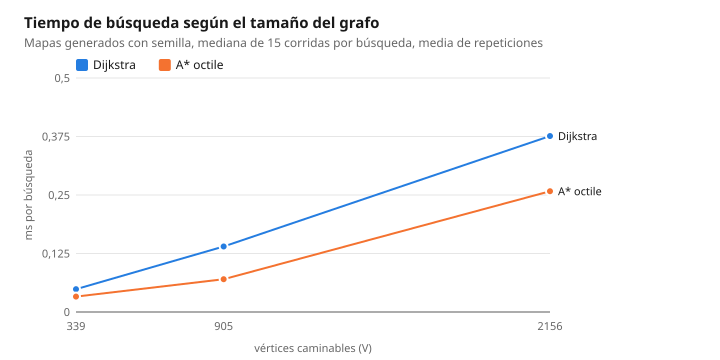
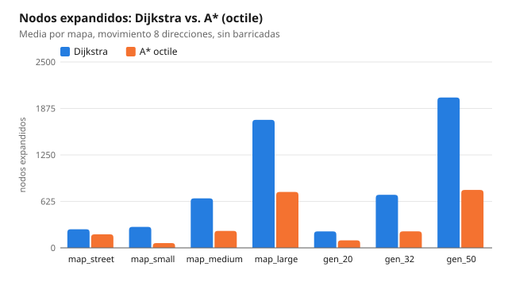
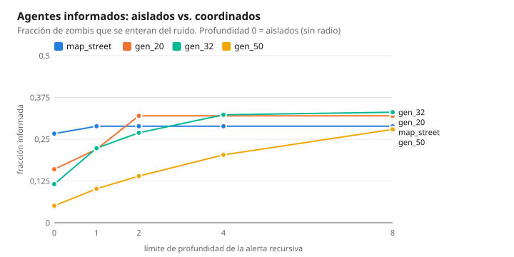
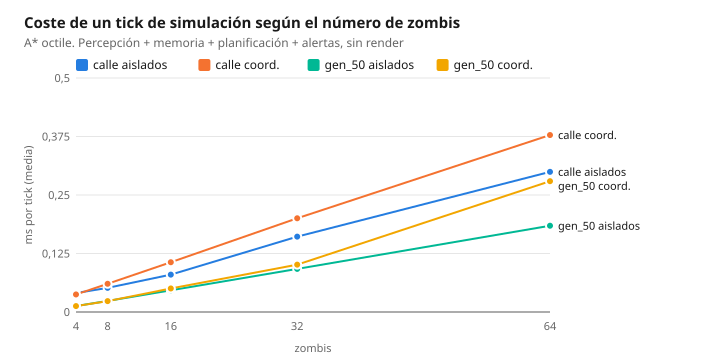

# Resultados experimentales

> Archivo generado por `npx tsx src/benchmarks/report.ts` a partir de los CSV de `src/benchmarks/results/`.
> No editar a mano: volver a correr `npm run benchmark` y luego el reporte.

Corrida: 2026-11-27T20:31:21.451Z · 12th Gen Intel(R) Core(TM) i5-12400F (12 núcleos) · Node v24.22.0 · linux x64.
Parámetros: tamaños 20, 32, 50, 5 repeticiones (una semilla distinta por repetición, semilla base 2026), 15 corridas internas por búsqueda (se guarda la mediana).

Mapas: `gen_N` son mapas generados de N x N con semilla; `map_small`, `map_medium`, `map_large` son los mapas fijos de `public/maps`; `map_street` es la cuadrícula del mundo FPV (46 x 56 celdas de 1 m, 284 celdas caminables en anillo).

## 1. Complejidad teórica contra medida

Dijkstra y A* con montículo binario cuestan O((V + E) log V). La columna "ns por unidad" divide el tiempo medido entre (V + E) log2 V: si la teoría se cumple, esa constante se mantiene en el mismo orden de magnitud al crecer el grafo. A* recorre solo una parte del grafo, así que su constante queda por debajo de la de Dijkstra.

| Mapa | V | E | (V+E) log2 V | Dijkstra ms | Dijkstra ns/unidad | A* ms | A* ns/unidad |
| --- | ---: | ---: | ---: | ---: | ---: | ---: | ---: |
| map_street | 284 | 1540 | 14865 | 0,0298 | 2 | 0,0335 | 2,25 |
| map_small | 361 | 2422 | 23644 | 0,037 | 1,56 | 0,0149 | 0,63 |
| map_medium | 845 | 5942 | 65989 | 0,0979 | 1,48 | 0,0595 | 0,9 |
| map_large | 1901 | 13088 | 163268 | 0,2734 | 1,67 | 0,2186 | 1,34 |
| gen_20 | 339 | 1983 | 19515 | 0,0488 | 2,5 | 0,0329 | 1,69 |
| gen_32 | 905 | 5870 | 66538 | 0,14 | 2,1 | 0,0701 | 1,05 |
| gen_50 | 2156 | 13898 | 177789 | 0,376 | 2,11 | 0,2581 | 1,45 |

## 2. Dijkstra contra A* (8 direcciones, sin barricadas)

"Razón de costo" = costo encontrado / costo óptimo (Dijkstra). 1 significa ruta óptima.

| Mapa | Algoritmo | Nodos expandidos | ms | Razón de costo | Óptimo |
| --- | ---: | ---: | ---: | ---: | ---: |
| map_street | Dijkstra | 250,2 | 0,0298 | 1 | 100 % |
| map_street | A* octile | 182 | 0,0335 | 1 | 100 % |
| map_street | A* euclídea | 197 | 0,0405 | 1 | 100 % |
| map_street | A* manhattan (no admisible en 8-dir) | 147,4 | 0,0297 | 1 | 100 % |
| map_small | Dijkstra | 282,3 | 0,037 | 1 | 100 % |
| map_small | A* octile | 64,4 | 0,0149 | 1 | 100 % |
| map_small | A* euclídea | 88 | 0,0226 | 1 | 100 % |
| map_small | A* manhattan (no admisible en 8-dir) | 33 | 0,0096 | 1,0358 | 10 % |
| map_medium | Dijkstra | 665,7 | 0,0979 | 1 | 100 % |
| map_medium | A* octile | 228,2 | 0,0595 | 1 | 100 % |
| map_medium | A* euclídea | 286,1 | 0,0891 | 1 | 100 % |
| map_medium | A* manhattan (no admisible en 8-dir) | 95,2 | 0,0265 | 1,019 | 0 % |
| map_large | Dijkstra | 1721,6 | 0,2734 | 1 | 100 % |
| map_large | A* octile | 752 | 0,2186 | 1 | 100 % |
| map_large | A* euclídea | 893,1 | 0,2861 | 1 | 100 % |
| map_large | A* manhattan (no admisible en 8-dir) | 421,7 | 0,1251 | 1,0172 | 10 % |
| gen_20 | Dijkstra | 221,4 | 0,0488 | 1 | 100 % |
| gen_20 | A* octile | 101,4 | 0,0329 | 1 | 100 % |
| gen_20 | A* euclídea | 122,5 | 0,037 | 1 | 100 % |
| gen_20 | A* manhattan (no admisible en 8-dir) | 29,1 | 0,0121 | 1,0213 | 30 % |
| gen_32 | Dijkstra | 713,5 | 0,14 | 1 | 100 % |
| gen_32 | A* octile | 222 | 0,0701 | 1 | 100 % |
| gen_32 | A* euclídea | 293,6 | 0,1056 | 1 | 100 % |
| gen_32 | A* manhattan (no admisible en 8-dir) | 43,8 | 0,0166 | 1,0258 | 30 % |
| gen_50 | Dijkstra | 2022,1 | 0,376 | 1 | 100 % |
| gen_50 | A* octile | 778,9 | 0,2581 | 1 | 100 % |
| gen_50 | A* euclídea | 974,4 | 0,3336 | 1 | 100 % |
| gen_50 | A* manhattan (no admisible en 8-dir) | 146 | 0,0504 | 1,0402 | 0 % |

Lectura: con heurísticas admisibles (octile, euclídea) A* encuentra siempre la ruta óptima (100 %) y expande menos nodos que Dijkstra. Manhattan en movimiento de 8 direcciones sobreestima (no es admisible): expande muy pocos nodos pero devuelve rutas hasta un ~3 % más caras. En movimiento de 4 direcciones Manhattan sí es admisible:

| Mapa | Dijkstra expandidos (4-dir) | A* manhattan expandidos (4-dir) | A* óptimo |
| --- | ---: | ---: | ---: |
| map_street | 252,2 | 193,5 | 100 % |
| map_small | 281,3 | 90,8 | 100 % |
| map_medium | 665,2 | 176,5 | 100 % |
| map_large | 1725,5 | 362,5 | 100 % |
| gen_20 | 219,3 | 129,4 | 100 % |
| gen_32 | 717,4 | 259 | 100 % |
| gen_50 | 2022,5 | 857,4 | 100 % |

## 3. Replanificación con barricadas

Se bloquean 3 celdas de la ruta óptima (como hace la barricada de Mara) y se vuelve a buscar sobre el grafo actualizado.

| Mapa | Algoritmo | Nodos expandidos | Costo medio | Óptimo |
| --- | ---: | ---: | ---: | ---: |
| map_street | Dijkstra | 121,1 | 6,58 | 100 % |
| map_street | A* octile | 107,7 | 6,58 | 100 % |
| map_small | Dijkstra | 284,3 | 19,255 | 100 % |
| map_small | A* octile | 75,4 | 19,255 | 100 % |
| map_medium | Dijkstra | 668,8 | 34,559 | 100 % |
| map_medium | A* octile | 234,2 | 34,559 | 100 % |
| map_large | Dijkstra | 1724,8 | 64,924 | 100 % |
| map_large | A* octile | 755,6 | 64,924 | 100 % |
| gen_20 | Dijkstra | 250 | 23,698 | 100 % |
| gen_20 | A* octile | 112,4 | 23,698 | 100 % |
| gen_32 | Dijkstra | 722,8 | 38,437 | 100 % |
| gen_32 | A* octile | 261,6 | 38,437 | 100 % |
| gen_50 | Dijkstra | 2029,7 | 68,553 | 100 % |
| gen_50 | A* octile | 834,1 | 68,553 | 100 % |

## 4. Alertas recursivas: aislados contra coordinados

Mismas semillas y mismas posiciones en ambos modos. Un ruido lo oyen solo los zombis dentro del radio de audición (5 celdas). Aislados: solo ellos reaccionan. Coordinados: cada oyente lanza la alerta recursiva por radio (alcance 7 celdas) con límite de profundidad.

| Mapa | Modo | Informados | Profundidad alcanzada | Pila máxima | Llamadas recursivas | ms |
| --- | ---: | ---: | ---: | ---: | ---: | ---: |
| map_street | aislados | 26,7 % | 0 | 0 | 0 | 0 |
| map_street | coordinados, prof. <= 1 | 28,9 % | 0,6 | 2 | 8 | 0,0046 |
| map_street | coordinados, prof. <= 2 | 28,9 % | 0,6 | 2 | 8 | 0,005 |
| map_street | coordinados, prof. <= 4 | 28,9 % | 0,6 | 2 | 8 | 0,0048 |
| map_street | coordinados, prof. <= 8 | 28,9 % | 0,6 | 2 | 8 | 0,0045 |
| gen_20 | aislados | 16 % | 0 | 0 | 0 | 0 |
| gen_20 | coordinados, prof. <= 1 | 22 % | 0,6 | 2 | 4,2 | 0,0508 |
| gen_20 | coordinados, prof. <= 2 | 32 % | 0,8 | 3 | 5,2 | 0,0123 |
| gen_20 | coordinados, prof. <= 4 | 32 % | 0,8 | 3 | 5,2 | 0,0093 |
| gen_20 | coordinados, prof. <= 8 | 32 % | 0,8 | 3 | 5,2 | 0,0111 |
| gen_32 | aislados | 11,5 % | 0 | 0 | 0 | 0 |
| gen_32 | coordinados, prof. <= 1 | 22,3 % | 0,6 | 2 | 14,4 | 0,0137 |
| gen_32 | coordinados, prof. <= 2 | 26,9 % | 1,2 | 3 | 25,4 | 0,0369 |
| gen_32 | coordinados, prof. <= 4 | 32,3 % | 2 | 5 | 33,6 | 0,2512 |
| gen_32 | coordinados, prof. <= 8 | 33,1 % | 2,4 | 7 | 36,8 | 0,0829 |
| gen_50 | aislados | 5,1 % | 0 | 0 | 0 | 0 |
| gen_50 | coordinados, prof. <= 1 | 10,2 % | 1 | 2 | 15,6 | 0,0141 |
| gen_50 | coordinados, prof. <= 2 | 14 % | 2 | 3 | 25,2 | 0,0438 |
| gen_50 | coordinados, prof. <= 4 | 20,3 % | 4 | 5 | 37,6 | 0,0766 |
| gen_50 | coordinados, prof. <= 8 | 27,9 % | 5,6 | 8 | 53,2 | 0,1199 |

La pila de llamadas nunca supera el límite de profundidad + 1, y el número de llamadas nunca supera el número de agentes: el conjunto de visitados impide ciclos.

## 5. Coste por tick con muchos zombis

Simulación completa sin render (`src/benchmarks/tickCost.ts`): Mara recorre la ruta óptima hacia la extracción y dispara cada 15 ticks. 200 ticks medidos por configuración y 3 semillas; cuando Mara muere empieza otro episodio con otra semilla para medir siempre el mismo número de ticks.

| Mapa | Zombis | Modo | ms/tick | p95 ms | Búsquedas/tick | Nodos/tick | Búsquedas redundantes | Informados por alerta |
| --- | ---: | ---: | ---: | ---: | ---: | ---: | ---: | ---: |
| map_street | 4 | coordinados | 0,0375 | 0,1373 | 0,88 | 35,5 | 0 % | 2,2 |
| map_street | 4 | aislados | 0,0406 | 0,0979 | 0,75 | 23,9 | 0 % | 0 |
| map_street | 8 | coordinados | 0,0603 | 0,2528 | 1,84 | 85,8 | 0 % | 5,82 |
| map_street | 8 | aislados | 0,0516 | 0,1327 | 1,48 | 50,4 | 0 % | 0 |
| map_street | 16 | coordinados | 0,1063 | 0,53 | 3,76 | 164,3 | 0 % | 11,83 |
| map_street | 16 | aislados | 0,0799 | 0,2733 | 2,97 | 93,4 | 0 % | 0 |
| map_street | 32 | coordinados | 0,2003 | 1,12 | 7,78 | 305,6 | 0 % | 19,22 |
| map_street | 32 | aislados | 0,161 | 0,385 | 6,15 | 211,7 | 0,03 % | 0 |
| map_street | 64 | coordinados | 0,3781 | 0,8778 | 15,83 | 467,1 | 0 % | 32,15 |
| map_street | 64 | aislados | 0,2995 | 1,0772 | 12,5 | 425,3 | 0 % | 0 |
| gen_32 | 4 | coordinados | 0,019 | 0,053 | 0,87 | 11,3 | 0 % | 1,06 |
| gen_32 | 4 | aislados | 0,0173 | 0,0488 | 0,8 | 10,3 | 0 % | 0 |
| gen_32 | 8 | coordinados | 0,0308 | 0,0751 | 1,61 | 23,7 | 0 % | 2,47 |
| gen_32 | 8 | aislados | 0,0252 | 0,065 | 1,43 | 19,1 | 0 % | 0 |
| gen_32 | 16 | coordinados | 0,0761 | 0,2349 | 3,67 | 83,3 | 0 % | 9,58 |
| gen_32 | 16 | aislados | 0,047 | 0,1258 | 2,71 | 38,4 | 0 % | 0 |
| gen_32 | 32 | coordinados | 0,1815 | 0,5847 | 7,58 | 221,9 | 0 % | 21,51 |
| gen_32 | 32 | aislados | 0,0915 | 0,2478 | 5,35 | 75,9 | 0 % | 0 |
| gen_32 | 64 | coordinados | 0,4012 | 1,6411 | 16,21 | 474,3 | 0 % | 42,82 |
| gen_32 | 64 | aislados | 0,1896 | 0,5282 | 10,82 | 162,5 | 0 % | 0 |
| gen_50 | 4 | coordinados | 0,0127 | 0,0339 | 0,63 | 7 | 0 % | 0,17 |
| gen_50 | 4 | aislados | 0,0128 | 0,0337 | 0,62 | 6,9 | 0 % | 0 |
| gen_50 | 8 | coordinados | 0,0233 | 0,0577 | 1,24 | 15 | 0 % | 0,94 |
| gen_50 | 8 | aislados | 0,0236 | 0,0572 | 1,21 | 13,6 | 0 % | 0 |
| gen_50 | 16 | coordinados | 0,0503 | 0,1352 | 2,46 | 32 | 0 % | 2,11 |
| gen_50 | 16 | aislados | 0,0464 | 0,1056 | 2,33 | 26,7 | 0 % | 0 |
| gen_50 | 32 | coordinados | 0,1012 | 0,2675 | 4,92 | 76,2 | 0 % | 5,58 |
| gen_50 | 32 | aislados | 0,0921 | 0,2294 | 4,43 | 54,1 | 0 % | 0 |
| gen_50 | 64 | coordinados | 0,2795 | 0,6647 | 10,71 | 211,8 | 0 % | 16,37 |
| gen_50 | 64 | aislados | 0,1843 | 0,5215 | 9,26 | 115,8 | 0 % | 0 |

Dijkstra contra A* dentro del juego (map_street, coordinados):

| Zombis | Dijkstra ms/tick | A* ms/tick | Dijkstra nodos/tick | A* nodos/tick |
| --- | ---: | ---: | ---: | ---: |
| 4 | 0,0345 | 0,0375 | 66,1 | 35,5 |
| 8 | 0,0673 | 0,0603 | 157,9 | 85,8 |
| 16 | 0,1253 | 0,1063 | 320 | 164,3 |
| 32 | 0,2464 | 0,2003 | 632 | 305,6 |
| 64 | 0,5053 | 0,3781 | 1136,6 | 467,1 |

Conclusiones:

- El presupuesto de un tick es de 385 ms en `map_street` (celdas de 1 m) y de 60 fps para el render. El peor p95 medido es 3,935 ms (gen_32, 64 zombis, coordinados): la IA no limita el rendimiento; el cuello de botella es el render.
- El coste crece de forma aproximadamente lineal con el número de zombis, porque cada zombi hace a lo sumo una búsqueda por tick.
- Búsquedas redundantes (misma salida, mismo destino, mismo algoritmo y grafo sin cambios): máximo 0,03 %. Los agentes ya replanifican solo cuando cambia el objetivo, la evidencia o el grafo. `PathCache` (`src/core/algorithms/pathCache.ts`) queda disponible para cuando varios zombis compartan destino o se añadan más agentes.
- La coordinación aumenta las búsquedas por tick (más zombis informados que se mueven hacia el ruido), que es justo el efecto buscado.
